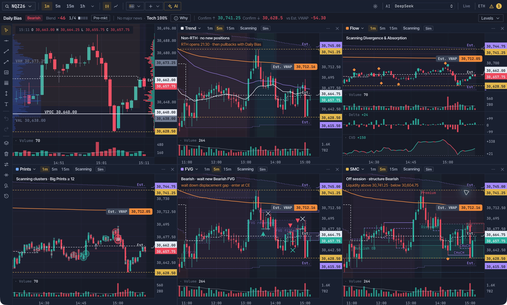
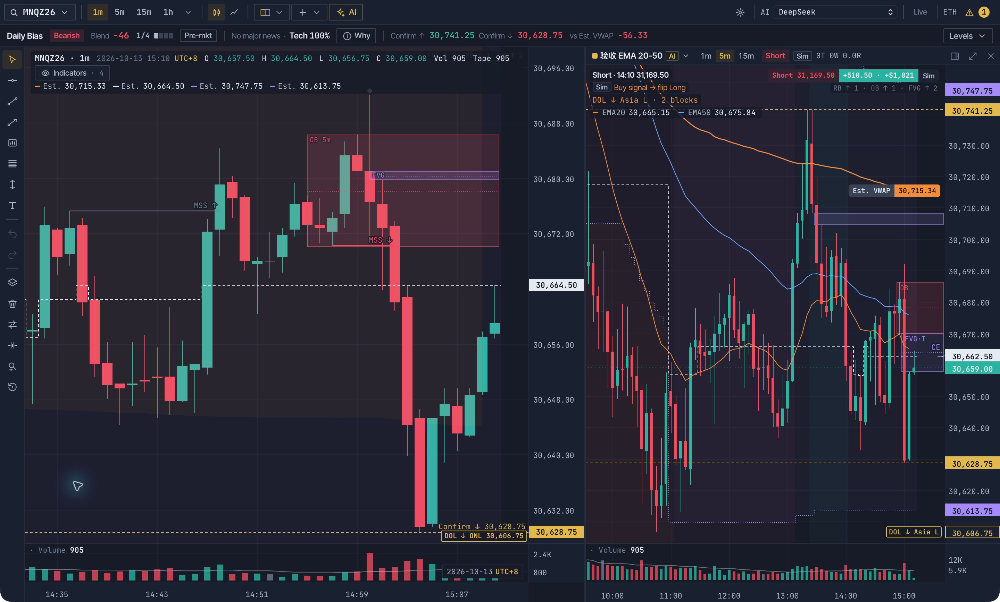
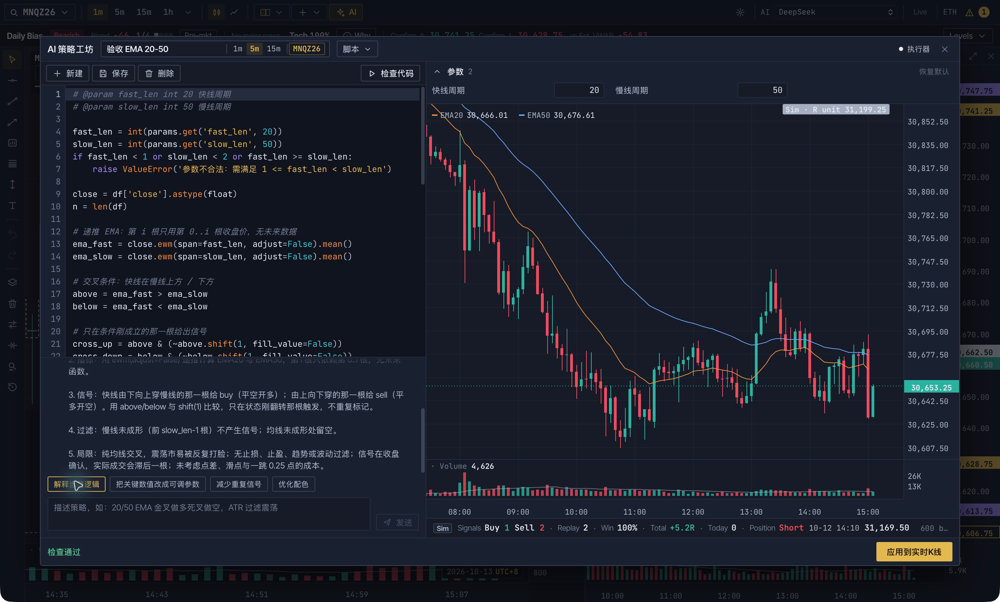
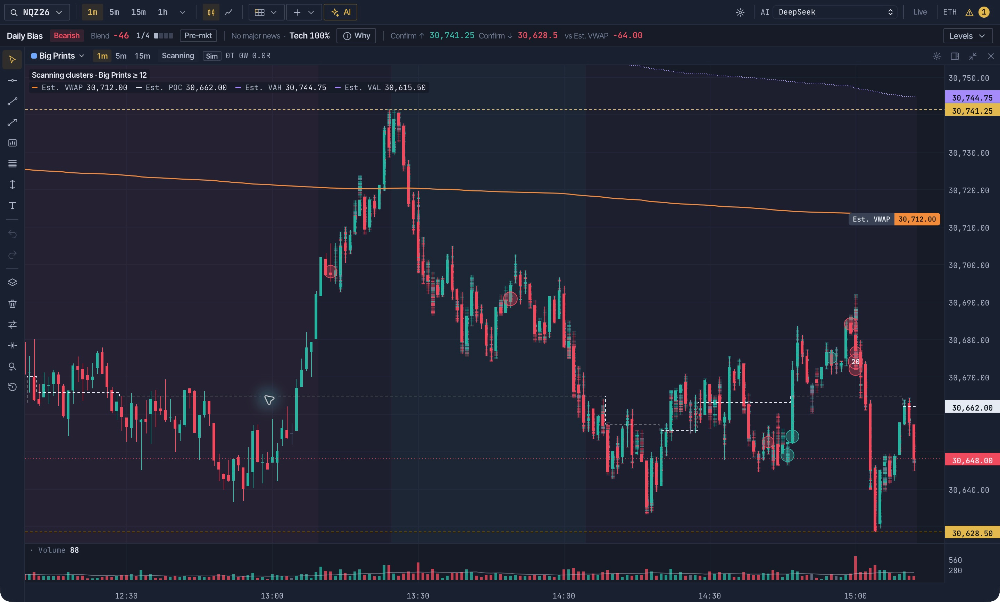
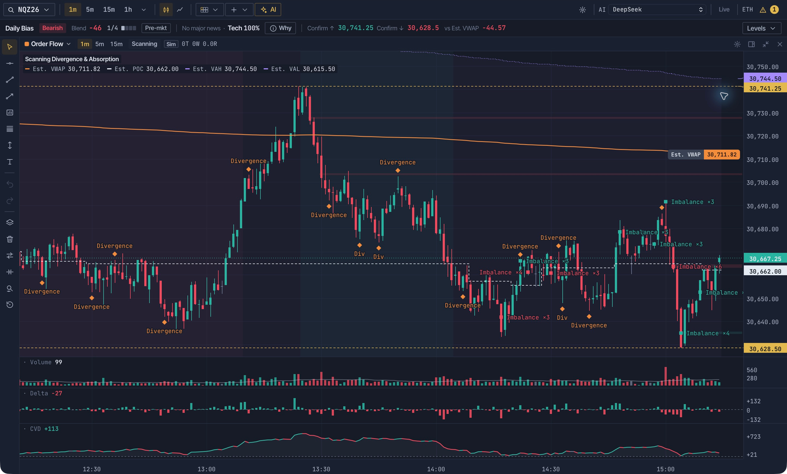
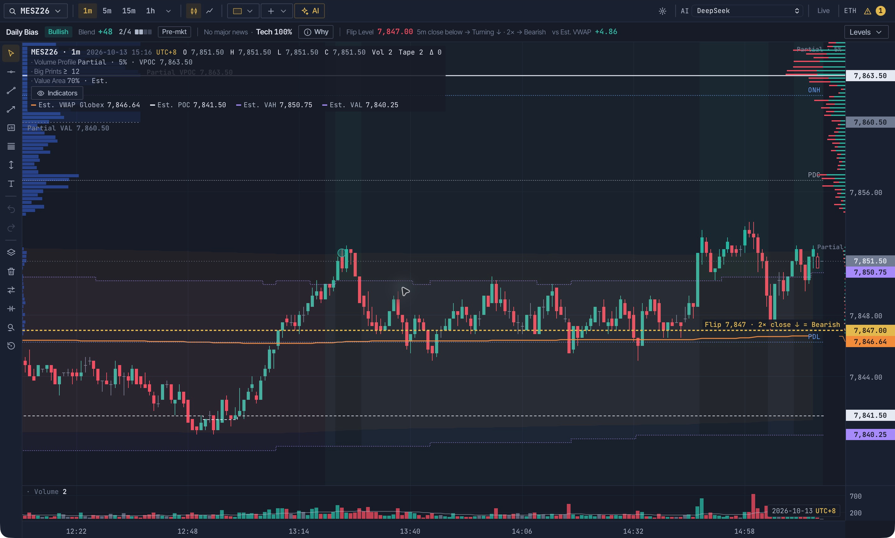
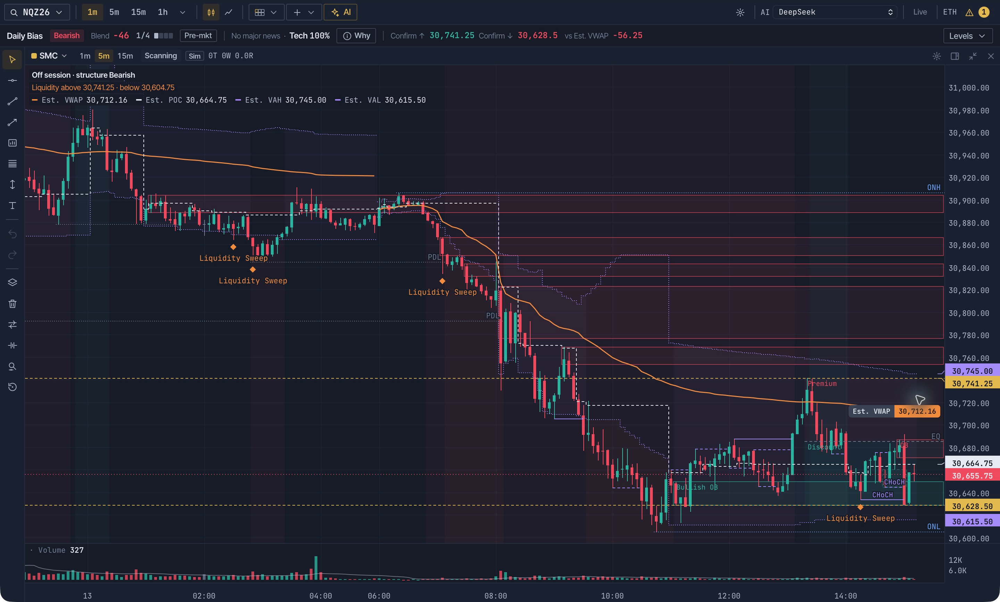
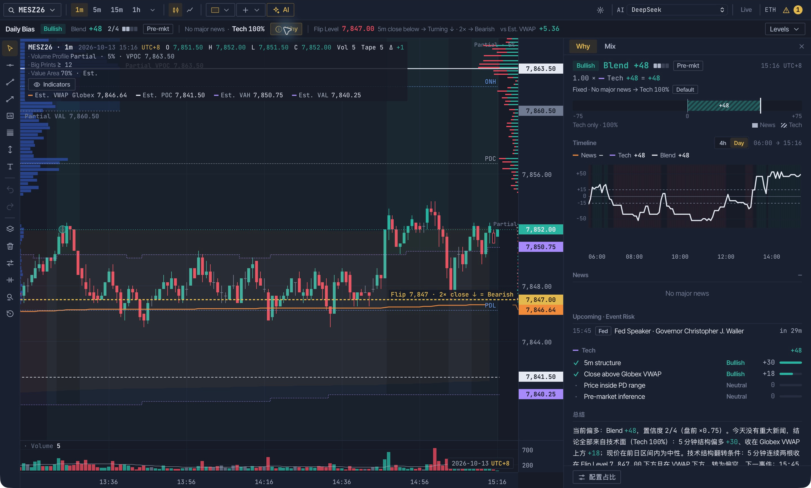
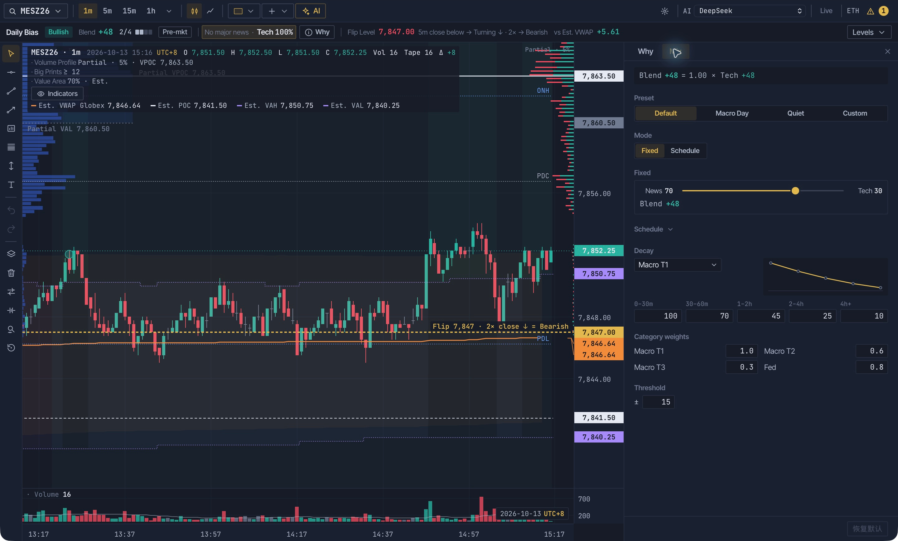
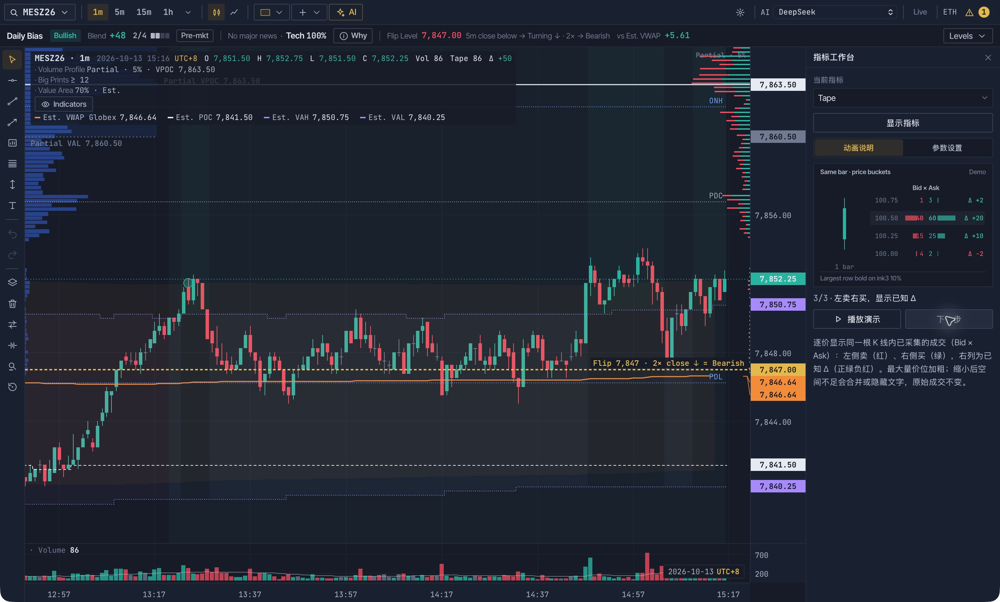

# Juudy

### 看价格，也看价格背后的成交与结构。

**CME 股指期货桌面工作台 · Windows / macOS** 
Price, order flow and market structure — in one workspace.

[下载 / Download](#download) · [功能图览 / Product tour](#product-tour) · [开始使用 / Get started](#get-started) · [English](#english)

**MNQ · NQ · MES · ES**　／　**Windows x64 · Apple silicon**　／　**中文 · English**

## 下载 / Download

**[⬇ Windows：下载安装 EXE](https://github.com/winnerway-boys/juudy/releases/download/v1.2.0-windows-20261016/Juudy-1.2.0-setup.exe)**　·　**[⬇ macOS：下载 DMG](https://github.com/winnerway-boys/juudy/releases/download/v1.4.0-macos-20261021/Juudy-1.4.0.dmg)**

| 平台 / Platform | 公开版本 / Version | 系统要求 / Requirements | 发布说明 / Release notes |
| :--- | :--- | :--- | :--- |
| **Windows** | **1.2.0 · 2026-10-16** | Windows 11 / Windows 10 22H2，64 位 x64 | [中文增强与 K 线倒计时 / Chinese UI & candle countdown](https://github.com/winnerway-boys/juudy/releases/tag/v1.2.0-windows-20261016) |
| **macOS** | **1.4.0 · 2026-10-21** | macOS 15+，Apple silicon（M1+） | [账号注册与策略云 / Accounts & Strategy Cloud](https://github.com/winnerway-boys/juudy/releases/tag/v1.4.0-macos-20261021) |

Windows 安装包约 **235 MiB**（246,532,458 字节）；[SHA256 校验文件](https://github.com/winnerway-boys/juudy/releases/download/v1.2.0-windows-20261016/Juudy-1.2.0-setup.exe.sha256)。选用对应平台的下载链接；两个平台的公开版本号可能不同。 / Choose the download for your operating system; public version numbers may differ by platform.

macOS 1.4.0 已更新：**用户名注册账号 + 策略云**（付费后换电脑、重装登录即可继续用）。安装包约 **47.2 MiB**；SHA256 见[发布页](https://github.com/winnerway-boys/juudy/releases/tag/v1.4.0-macos-20261021)。 / Updated macOS build: username accounts and Strategy Cloud.

01 / SIX-CHART WORKSPACE — 六宫格，一屏对照主图、Trend、Order Flow、Big Prints、FVG 与 SMC。点击截图查看高清原图。

Juudy 把实时行情、订单流、ICT 结构和策略研究放在同一张工作台里。先看整体结构，再查看成交细节，也可以把自己的想法交给 AI，生成 Python 策略并放到独立图表中模拟观察。

| 看清市场 | 对照策略 | 验证想法 |
| :--- | :--- | :--- |
| Candles · Big Prints · Footprint · CVD | 多图布局 · Trend · FVG · SMC | AI 写 Python · 沙盒检查 · 实时 Sim |

> **截图版本：Juudy 1.2.0（机主版实机）**。公开安装包版本请以 [Releases](https://github.com/winnerway-boys/juudy/releases) 为准；少量设置入口因版本不同而异。图中行情是截图时的市场状态，策略结果标记为 **Sim**，不代表真实成交或收益承诺。

## 一张工作台，多种观察角度

### 02 · 主图与策略并排 / Price & strategy side by side

从六宫格全景到双图专注视野，按需要选择布局。主图与策略窗格各自使用不同周期，显示自己的状态、规则条件与模拟信号；图中右侧是 AI 生成的 EMA 策略。需要细看时，单独放大一个窗格。

*Move between the six-chart overview and a focused side-by-side workspace, with an independent timeframe for each pane.*

### 03 · 把想法变成可运行的策略 / AI Strategy Studio

**描述想法 → 生成 Python → 检查代码 → 应用到实时 K 线。**

代码、参数和预览同屏展示，支持继续提问、解释逻辑和调整参数。检查包括隔离执行、输出格式校验和前缀重算，帮助发现执行错误与部分未来数据问题；不等于策略有效性或收益保证。AI 使用你自己接入的服务商与 API Key。

*Describe an idea, inspect the generated Python, run the checks, then follow its simulated signals on a dedicated live chart.*

## 从成交中读细节

<table>
<tr>
<td width="50%" valign="top">

### 04 · Big Prints & Trade Heatmap

大单气泡突出较大的成交，逐价热力呈现成交的分布与主动方向。阈值可调，结合当前周期控制显示密度。方向色统一：主动买为绿，主动卖为红。

*Inspect larger prints and traded volume inside each bar.*

</td>
<td width="50%" valign="top">

### 05 · CVD & Delta

把价格、每根 K 线的 Delta 和累计 CVD 放在同一视野，对照 Divergence 与 Imbalance 标记。计算基于已采集逐笔，缺口不能视为完整成交记录。

*Compare price, bar Delta and cumulative Delta using the trades actually collected.*

</td>
</tr>
<tr>
<td width="50%" valign="top">

### 06 · Volume Profile & Value Area

查看成交集中在哪里，对照 POC、VAH、VAL 与 VWAP。数据不足时保留估算标识，区分实际逐笔分布与基于 K 线的估算。

*Read where volume traded, with value-area levels and estimated-data labels.*

</td>
<td width="50%" valign="top">

### 07 · ICT Market Structure

把 FVG、Order Blocks、BOS / CHoCH 和流动性参考放回价格结构中观察。图层按需显示，保留业内英文术语，方便交流与复盘。

*Inspect FVG, blocks, structure changes and liquidity references in price context.*

</td>
</tr>
</table>

## 看结论，也能看依据

<table>
<tr>
<td width="50%" valign="top">

### 08 · Daily Bias · Why

从 Daily Bias 查看当前规则判断，再展开 Why 阅读依据、技术条件与事件状态。Flip Level 给出结构变化的观察参考，条件变化时判断随之更新。

*Open the reasoning behind the current bias and track its structural flip conditions.*

</td>
<td width="50%" valign="top">

### 09 · 自定义分析权重 / Bias Mix

用 Fixed 或 Schedule 配置宏观事件与技术面的占比，并调整事件影响的时间衰减、分类权重和判断阈值。无重大新闻时，界面明确显示 Tech 100%，不强行给新闻凑分。

*Configure the news–technical mix and time decay; see when the result falls back to technical evidence alone.*

</td>
</tr>
</table>

### 10 · 指标教学与参数 / Learn the indicators

不熟悉一个指标时，直接打开它的说明，结合分步演示理解图形、数值与状态，再按需要调整参数。教学演示有 **Demo** 标识，与真实行情分开。

*Learn the visual language of an indicator with an in-app, step-by-step demo before adjusting its parameters.*

---

## 开始使用

| 准备 | 要求 |
| :--- | :--- |
| Windows | Windows 11 或 Windows 10 22H2，64 位 x64（Intel / AMD） |
| Mac | macOS 15 及以上，Apple 芯片（M1 及以后） |
| CME 行情 | **TopstepX 账户 + ProjectX API 订阅**；当前不支持其他公司的账户 |
| AI 工坊 | 自己的 AI API Key，例如 DeepSeek、智谱 GLM、火山方舟、通义千问 |

1. 根据电脑系统安装：**Windows** 用户[下载 EXE](https://github.com/winnerway-boys/juudy/releases/download/v1.2.0-windows-20261016/Juudy-1.2.0-setup.exe)，双击 `Juudy-1.2.0-setup.exe`，按安装向导完成安装；**Mac** 用户[下载 DMG](https://github.com/winnerway-boys/juudy/releases/download/v1.4.0-macos-20261021/Juudy-1.4.0.dmg)，打开后把 Juudy 拖进「应用程序」。
2. 首次打开如被 macOS 拦截，可在「系统设置 → 隐私与安全性」查看提示，确认文件来自本仓库后点「仍要打开」。
3. 按应用中的向导接入 AI 和 ProjectX，步骤中附有看图教程。未接入的功能暂不可用，可稍后补配。

GitHub 无法访问或下载较慢时，请使用适合自己网络环境的访问方式。每个安装包的 SHA256 均列在对应平台的 Release 中。Windows 可在 PowerShell 中运行 `Get-FileHash .\Juudy-1.2.0-setup.exe -Algorithm SHA256`；Mac 可运行 `shasum -a 256 Juudy-1.4.0.dmg`，与发布页提供的校验值核对。

### 试用、授权与反馈

每个版本可免费试用 **14 天**。到期后，将软件内的**申请码**发邮件至 **996032777@qq.com**，收到解锁码后粘贴到软件中。解锁码仅适用于申请时的那台电脑和那个版本。

问题反馈：应用内「设置 → 问题反馈」，或邮件 **996032777@qq.com**。

<strong>English · Requirements, installation and licensing</strong>

### What you need

- **Windows:** Windows 11 or Windows 10 22H2, 64-bit x64 (Intel / AMD).
- **Mac:** macOS 15 or later on an Apple-silicon Mac (M1 or newer).
- A **TopstepX account with a ProjectX API subscription**. Other firms' accounts, including Lucid, Apex, Tradeify and TakeProfitTrader, are not supported.
- Your own AI API key for the AI Strategy Studio, for example DeepSeek, Zhipu GLM, Volcano Ark or Qwen.

### Install

1. Choose your platform: **Windows** — [download the EXE](https://github.com/winnerway-boys/juudy/releases/download/v1.2.0-windows-20261016/Juudy-1.2.0-setup.exe), open `Juudy-1.2.0-setup.exe`, and follow the installer. **Mac** — [download the DMG](https://github.com/winnerway-boys/juudy/releases/download/v1.4.0-macos-20261021/Juudy-1.4.0.dmg) and drag Juudy into Applications.
2. If macOS blocks the first launch, check System Settings → Privacy & Security. Confirm that the file came from this repository before choosing **Open Anyway**.
3. Follow the illustrated in-app setup wizard. Connections can be completed later; features that need an unconfigured service remain unavailable.

Screenshots show the **1.2.0 owner build**. Check the [download table](#download) for the publicly available version on each platform. The screenshots are product demonstrations, not a performance record. All strategy results are **simulated**.

### Trial and support

Each version includes a **14-day free trial**. Email the in-app request code to **996032777@qq.com** for an unlock code valid for that computer and version. Use Settings → Feedback or the same email for support.

Each platform's Release includes the installer's SHA256 checksum. On Windows, run `Get-FileHash .\Juudy-1.2.0-setup.exe -Algorithm SHA256` in PowerShell. On Mac, run `shasum -a 256 Juudy-1.4.0.dmg`. Compare the result with the checksum on the corresponding Release.

---

Juudy 仅读取行情，不执行实盘下单。所有策略信号均为 Sim，仅供研究和学习，不构成投资建议。期货交易风险很高。 / Juudy reads market data and does not place live orders. All strategy signals are simulated, for research and learning only, not investment advice. Futures trading carries high risk.

© 2026 Juudy. 本仓库只提供安装包与产品介绍，不包含应用源代码。 / Installers and product documentation only; no application source code. All rights reserved. See [LICENSE](LICENSE).
